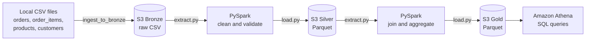

# E-Commerce ETL Pipeline

A batch data pipeline that ingests raw e-commerce CSV files into **Amazon S3**, cleans and validates them with **PySpark**, builds business-ready tables, and makes them queryable with **Amazon Athena**. It follows the **medallion architecture** (bronze, silver, gold).

## Business requirement

An e-commerce company wants a dashboard to monitor:

- Daily sales revenue.
- Total orders.
- Top-selling products.
- Customer purchase behaviour.
- Monthly revenue growth.
- Cancelled and returned orders.

The gold layer answers each requirement:

| Requirement | Gold table | How it is answered |
|---|---|---|
| Daily sales revenue | `gold` | Sum `total_price` by `order_date` for Completed orders |
| Total orders | `monthly_revenue` | `total_orders` for each month |
| Top-selling products | `top_selling_products` | Highest-revenue product in each category |
| Customer purchase behaviour | `customer_revenue` | Number of orders and revenue for each customer |
| Monthly revenue growth | `monthly_revenue` | Compare each month's `monthly_revenue` with the previous month |
| Cancelled and returned orders | `return_rate`, `gold` | `return_rate` gives returned units by category. Cancelled orders come from `gold` where `status = 'Cancelled'` |

## Architecture



| Layer | Location | Format | What it holds |
|---|---|---|---|
| Bronze | `s3://suvithra-bronze/e-commerce/` | CSV, unchanged | Raw files exactly as received |
| Silver | `s3://suvithra-silver/e-commerce/` | Parquet | Cleaned, deduplicated, correctly typed `orders`, `order_items` (with product details) and `customers` |
| Gold | `s3://suvithra-gold/e-commerce/` | Parquet | One row per order item (`gold/`, partitioned by `year`) plus five aggregate tables |

## Tech stack

- **PySpark 3.5+** (uses `try_to_timestamp`)
- **Amazon EC2** with a Spark virtual environment to run the processing
- **Amazon S3** for storage, accessed from Spark through the `s3a://` connector (`hadoop-aws`)
- **Amazon Athena** (serverless SQL over S3) with tables defined by `CREATE EXTERNAL TABLE`

## Dataset

| File | Rows | Columns |
|---|---|---|
| `orders.csv` | 102,000 | order_id, customer_id, order_date, status, payment_method, shipping_city |
| `order_items.csv` | 193,085 | item_id, order_id, product_id, quantity, unit_price, discount_pct |
| `products.csv` | 300 | product_id, product_name, category, brand, unit_price |
| `customers.csv` | 5,150 | customer_id, name, email, city, signup_date, annual_income |

## Data quality rules (bronze to silver)

The raw files contain realistic problems. Each one has an explicit rule:

| Issue in the raw data | Handling |
|---|---|
| Dates in several formats (`yyyy-MM-dd`, `dd-MM-yyyy`, `dd/MM/yyyy`, `yyyy/MM/dd`) and invalid text such as `bad-date` | Parsed with each format in order, first match wins. Rows that still fail to parse are dropped |
| Duplicate `order_id`, `item_id`, `customer_id`, `product_id` | Deduplicated on the key |
| Orders with no `customer_id` (2,051 in the sample data) | Dropped, because the order cannot be linked to a customer |
| Inconsistent text such as `completed`, ` Completed`, `SPORTS` | Trimmed and normalised (`initcap` for status and city, lower case for category and payment method) |
| Missing `quantity`, or quantity of 0 or less | Row dropped |
| Zero, negative or missing `unit_price` | Treated as missing, then filled from the product's list price. Rows with no price at all are dropped |
| Items whose `product_id` is not in the products table | Kept (a sale is still a sale) with category `unknown` and product name `Unknown Product` |
| Missing brand, status, payment method or shipping city | Filled with `not specified` or `Unknown` |
| Invalid email format | Replaced with `invalid` |
| Zero or negative `annual_income` | Set to null |

## Gold tables

| Table | Grain | Definition |
|---|---|---|
| `gold` | one row per order item | Items joined to orders (inner) and customers (left), with `total_price` |
| `monthly_revenue` | year, month | Revenue and orders for Completed orders |
| `top_selling_products` | category | Highest-revenue product in each category (Completed) |
| `category_revenue` | category | Revenue by category (Completed) |
| `customer_revenue` | customer | Orders and revenue per customer (Completed) |
| `return_rate` | category | Returned units divided by shipped units (Completed plus Returned) |

## Project structure

```
.
├── main.py               # runs bronze -> silver -> gold
├── extract.py            # read from bronze (CSV) and silver (Parquet)
├── transform.py          # cleaning rules and gold business logic
├── load.py               # write silver and gold as Parquet
└── README.md
```

## Setup

**Prerequisites**
- A Spark virtual environment with `pyspark` installed
- Java 11 or 17 (required by Spark)
- Three S3 buckets in the same AWS region: bronze, silver and gold
- AWS credentials with read and write access to those buckets. On EC2, attach an IAM role. Locally, run `aws configure`. Never commit keys.

## Run

Enter the Spark environment and run the pipeline:
```bash
source ~/spark-env/bin/activate
python main.py
```
This reads bronze, writes silver, reads silver back, then writes the gold fact table and the five aggregate tables.

## Query with Athena

Set a query result location in Athena settings first. Then create the database and tables. The column types below come from Spark's inferred schema, so confirm each one with `df.printSchema()` before creating the table.

```sql
CREATE DATABASE IF NOT EXISTS ecommerce_gold;

-- fact table, partitioned by year
CREATE EXTERNAL TABLE IF NOT EXISTS ecommerce_gold.gold (
  order_id int, item_id int, order_date date, customer_id int,
  customer_city string, shipping_city string,
  product_id string, product_name string, category string, brand string,
  quantity int, unit_price double, discount int, total_price double,
  status string, payment_method string, `month` int
)
PARTITIONED BY (`year` int)
STORED AS PARQUET
LOCATION 's3://suvithra-gold/e-commerce/gold/'
TBLPROPERTIES (
  'projection.enabled'='true',
  'projection.year.type'='integer',
  'projection.year.range'='2024,2030',
  'storage.location.template'='s3://suvithra-gold/e-commerce/gold/year=${year}'
);

CREATE EXTERNAL TABLE IF NOT EXISTS ecommerce_gold.monthly_revenue (
  `year` int, `month` int, monthly_revenue double, total_orders bigint
)
STORED AS PARQUET
LOCATION 's3://suvithra-gold/e-commerce/monthly_revenue/';

CREATE EXTERNAL TABLE IF NOT EXISTS ecommerce_gold.category_revenue (
  category string, revenue_by_category double
)
STORED AS PARQUET
LOCATION 's3://suvithra-gold/e-commerce/category_revenue/';

CREATE EXTERNAL TABLE IF NOT EXISTS ecommerce_gold.customer_revenue (
  customer_id int, num_of_orders bigint, revenue_by_customer double
)
STORED AS PARQUET
LOCATION 's3://suvithra-gold/e-commerce/customer_revenue/';

CREATE EXTERNAL TABLE IF NOT EXISTS ecommerce_gold.return_rate (
  category string, returned_units bigint, shipped_units bigint, return_rate_pct double
)
STORED AS PARQUET
LOCATION 's3://suvithra-gold/e-commerce/return_rate/';

CREATE EXTERNAL TABLE IF NOT EXISTS ecommerce_gold.top_selling_products (
  category string, product_id string, product_name string,
  revenue_per_product double, rank_in_category int
)
STORED AS PARQUET
LOCATION 's3://suvithra-gold/e-commerce/top_selling_products/';
```

Example queries:
```sql
-- revenue by month
SELECT "year", "month", monthly_revenue, total_orders
FROM ecommerce_gold.monthly_revenue
ORDER BY "year", "month";

-- categories with the highest return rate
SELECT category, return_rate_pct
FROM ecommerce_gold.return_rate
ORDER BY return_rate_pct DESC;

-- payment method mix for completed orders in 2026
SELECT payment_method, ROUND(SUM(total_price), 2) AS revenue
FROM ecommerce_gold.gold
WHERE "year" = 2026 AND status = 'Completed'
GROUP BY payment_method
ORDER BY revenue DESC;
```

## Design decisions

- **Bronze stays raw.** Files are copied unchanged, so any cleaning bug can be fixed and replayed from the original data.
- **Parquet from silver onward.** It is columnar and compressed, and Athena scans only the columns a query uses, which lowers cost.
- **Silver is read back from S3 before building gold.** Gold is built from the stored silver layer, not from in-memory objects, so each layer can be rerun on its own.
- **Left join for items and products.** An inner join would silently remove sales whose product is missing from the product table. A left join keeps the revenue and labels the product as unknown.
- **Inner join for items and orders.** An item with no matching clean order is not a valid sale.
- **Gold fact table partitioned by year only.** The data is small, so month-level partitions would create many tiny files, which slows Athena. Partitioning can be refined as the data grows.
- **Aggregate tables written as a single file** (`coalesce(1)`), because they hold tens to thousands of rows.
- **Dynamic partition overwrite.** Rerunning the job replaces only the affected year partitions, not the whole table.
- **Customer name and email stay in silver.** The gold table carries only `customer_id` and city, so analytics users do not see personal data.

## Author

Suvithra Murugan / [www.linkedin.com/in/suvithra-murugan](https://www.linkedin.com/in/suvithra-murugan)
